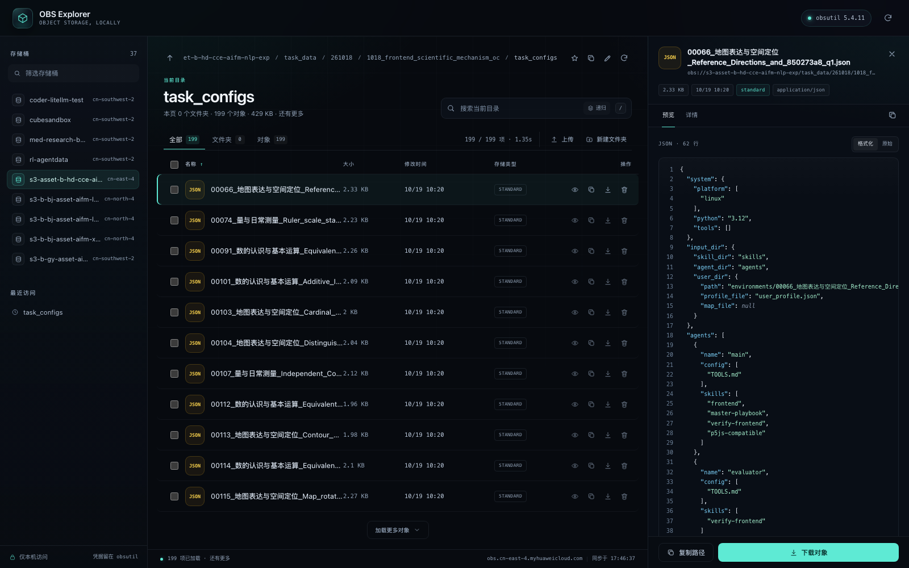
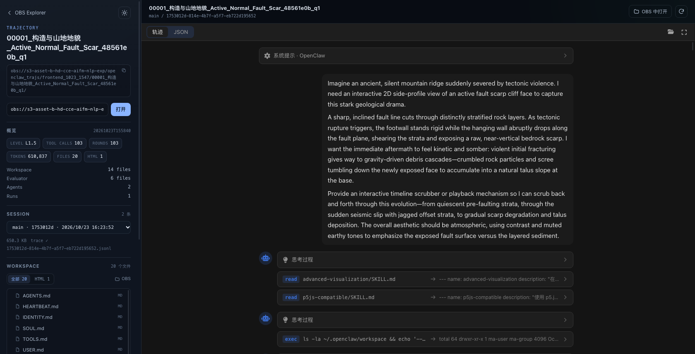
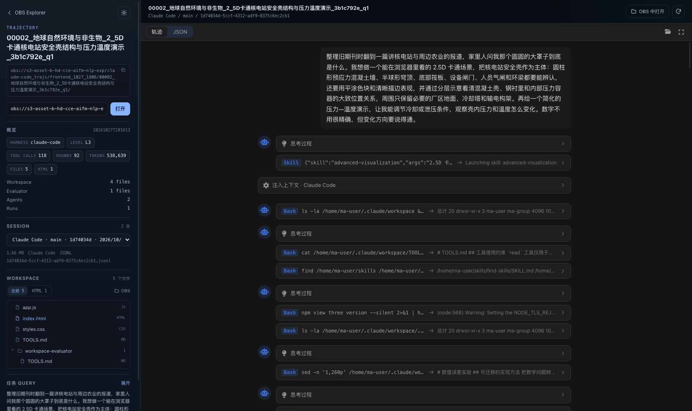
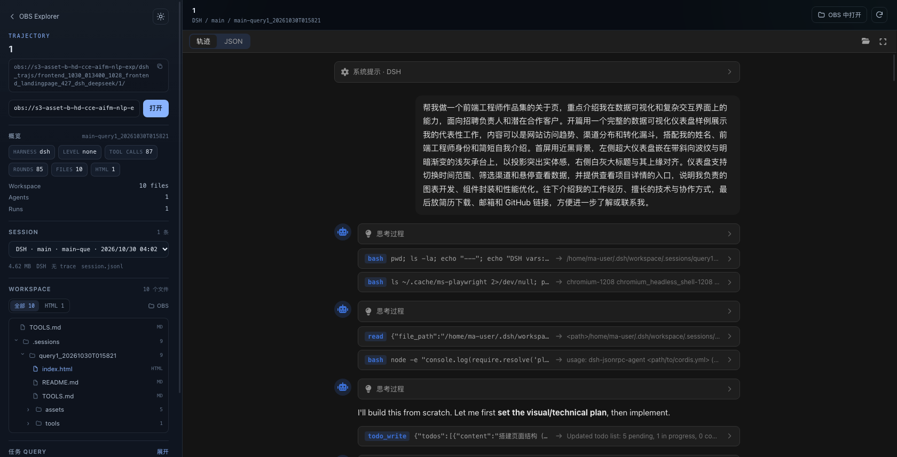
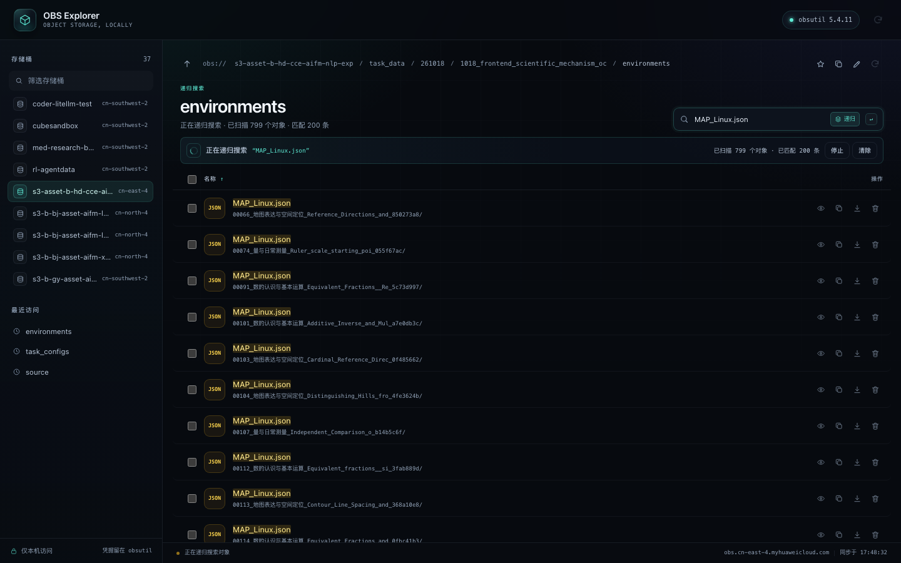
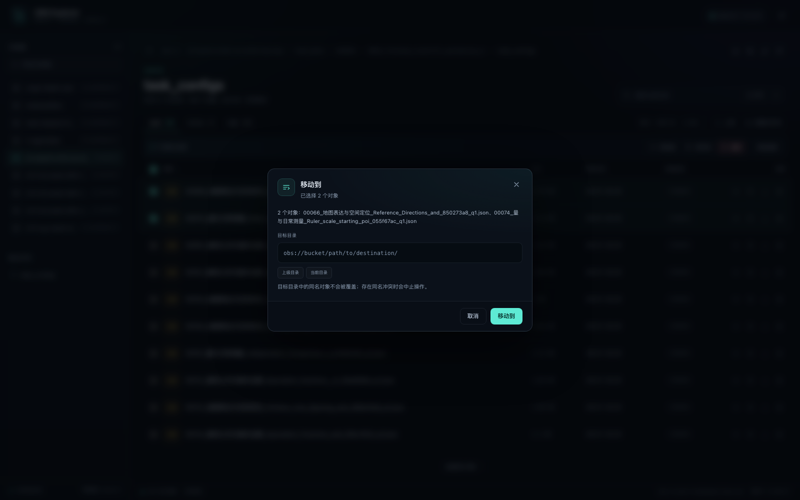
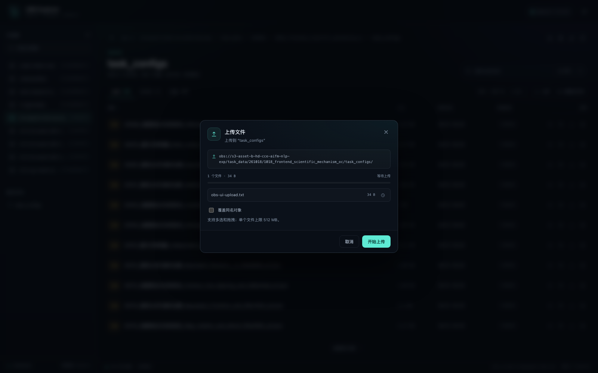

# OBS Explorer

一个运行在本机的 OBS 对象浏览界面。它直接调用本机已配置好的 `obsutil`，可以浏览桶、逐级查看前缀、搜索和过滤对象，并预览 JSON / 文本 / 图片等文件。



## 前置条件

项目本身不包含 OBS 凭据，也不会绕过 `obsutil` 访问 OBS。运行前需要：

1. **Node.js 20+**
2. **安装 obsutil**
   - 官方下载与安装说明：<https://support.huaweicloud.com/utiltg-obs/obs_11_0003.html>
   - 安装后确认命令可用：

     ```bash
     obsutil version
     ```

3. **配置 obsutil**
   - 使用交互式配置：

     ```bash
     obsutil config -interactive
     ```

   - 或直接指定 endpoint / AK / SK（endpoint 需要和桶所在地域一致）：

     ```bash
     obsutil config \
       -e=https://obs.cn-east-4.myhuaweicloud.com \
       -i="<your-access-key-id>" \
       -k="<your-secret-access-key>"
     ```

   - 验证能否访问 OBS：

     ```bash
     obsutil ls
     obsutil ls obs://your-bucket/
     ```

   - 如果 `obsutil` 不在 `PATH` 中，在 `.env` 里通过 `OBSUTIL_BIN` 指定绝对路径。
   - 如果配置文件不在默认的 `~/.obsutilconfig`，通过 `OBSUTIL_CONFIG` 指定路径。
   - `obsutil` 默认还会使用 `~/.obsutilAppData/` 保存凭据加密数据；服务启动时会把配置文件和该目录一起复制到隔离的临时运行目录。

> `.env` 管理的是本项目的运行参数。OBS 的 AK/SK 仍由 `obsutil` 自己的配置文件管理，不需要、也不建议写进前端；如需使用自定义配置文件，把 `OBSUTIL_CONFIG` 指向该文件即可。

## 快速开始

```bash
cp .env.example .env
# 按需编辑 .env
npm start
```

打开 <http://127.0.0.1:4318>。

默认会打开这个目录（可在 `.env` 中修改）：

```text
obs://s3-asset-b-hd-cce-aifm-nlp-exp/task_data/261018/1018_frontend_scientific_mechanism_oc/task_configs/
```

## 配置：`.env`

服务启动时会自动读取项目根目录下的 `.env`。已经通过 shell 设置的环境变量优先级更高，不会被 `.env` 覆盖。

仓库提供了 [`.env.example`](.env.example)，可以直接复制：

```bash
cp .env.example .env
```

示例：

```dotenv
PORT=4318
HOST=127.0.0.1

OBS_DEFAULT_PATH=obs://s3-asset-b-hd-cce-aifm-nlp-exp/task_data/261018/1018_frontend_scientific_mechanism_oc/task_configs/

# 可选：obsutil 可执行文件绝对路径
# OBSUTIL_BIN=/opt/homebrew/bin/obsutil

# 可选：自定义 obsutil 配置文件路径
# OBSUTIL_CONFIG=/Users/you/.obsutilconfig

# 可选：上传、搜索、批量操作限制
# OBS_MAX_UPLOAD_BYTES=536870912
# OBS_SEARCH_MAX_RESULTS=300
# OBS_SEARCH_MAX_SCAN=20000
# OBS_SEARCH_MAX_PAGES=200
# OBS_BATCH_MAX_ITEMS=200
# OBS_BATCH_CONCURRENCY=4

# 可选：目录总数统计的缓存与上限
# OBS_COUNT_CACHE_MS=300000
# OBS_COUNT_MAX_ENTRIES=100000
```

`.env` 已加入 `.gitignore`，不要把它提交到仓库。

### 环境变量

| 变量 | 说明 | 默认值 |
| --- | --- | --- |
| `PORT` | 本地监听端口 | `4318` |
| `HOST` | 监听地址 | `127.0.0.1` |
| `OBS_DEFAULT_PATH` | 打开页面时显示的默认目录 | 上面的 task_configs 路径 |
| `OBSUTIL_BIN` | obsutil 可执行文件或绝对路径 | `obsutil` |
| `OBSUTIL_CONFIG` | 自定义 obsutil 配置文件 | `~/.obsutilconfig` |
| `OBS_AUTH_TOKEN` | 共享访问口令；设置后需登录，留空则无鉴权 | 空（关闭） |
| `OBS_LIST_CACHE_MS` | 目录列表缓存时长（毫秒），`0` 关闭 | `30000` |
| `OBS_LIST_STALE_MS` | 列表过期后仍可先返回旧数据并后台刷新的时长（毫秒） | `600000` |
| `OBS_STAT_CACHE_MS` | 对象元数据缓存时长（毫秒），`0` 关闭 | `120000` |
| `OBS_BUCKET_CACHE_MS` | 桶列表缓存时长（毫秒），`0` 关闭 | `300000` |
| `OBS_COUNT_CACHE_MS` | 目录总数缓存时长（毫秒），`0` 关闭 | `300000` |
| `OBS_COUNT_MAX_ENTRIES` | 目录总数最多统计多少项，超出显示为 `≥N` | `100000` |
| `OBS_SEARCH_MAX_RESULTS` | 递归搜索最多返回结果数 | `300` |
| `OBS_SEARCH_MAX_SCAN` | 递归搜索最多扫描对象数 | `20000` |
| `OBS_SEARCH_MAX_PAGES` | 递归搜索最多请求页数 | `200` |
| `OBS_MAX_UPLOAD_BYTES` | 单文件上传大小上限（字节） | `536870912`（512 MB） |
| `OBS_BATCH_MAX_ITEMS` | 单次批量操作最多对象数 | `200` |
| `OBS_BATCH_CONCURRENCY` | 批量操作并发数 | `4` |

## 访问口令（部署到服务器时使用）

默认只监听 `127.0.0.1`，不需要登录。把服务放到服务器上、需要从别的机器访问时，务必设置访问口令：

```dotenv
HOST=0.0.0.0
OBS_AUTH_TOKEN=<一段足够长的随机字符串>
```

开启后：

- 未登录访问页面会跳到 `/login`，未登录调用 `/api/*` 返回 `401`
- 登录后下发 `HttpOnly; SameSite=Lax` cookie（30 天），cookie 里是口令的 HMAC，不含口令本身
- 想跳过表单，可访问一次 `http://<host>:4318/?token=<口令>`，服务端换取 cookie 后自动把口令从地址栏去掉
- 右上角「退出登录」→ `/logout`
- 同一来源 10 分钟内失败 8 次会被临时限流

> 口令走明文 HTTP 时可能被链路嗅探，公网访问建议在反向代理上再加一层 HTTPS。

## 功能

- 地址栏面包屑、返回上级、手动输入任意 `obs://` 路径
- 存储桶列表、存储桶筛选、最近访问、固定常用路径
- 文件夹逐级浏览，对象大小 / 修改时间 / 存储类型 / ETag
- 当前目录搜索、按文件夹 / 对象过滤、按名称 / 大小 / 时间排序
- **当前目录全量搜索**：按 Enter 搜索当前层全部直接子项（含未加载分页），实时进度、随时停止，支持断点续搜
- **递归文件名搜索**：在当前目录及所有子目录中匹配文件名，支持 `*` / `?` 通配符、实时进度、停止和结果路径展示
- 新建文件夹、拖拽/选择上传文件、覆盖同名对象、删除对象或递归删除文件夹
- **批量操作**：勾选多个对象后移动到、拷贝到或批量删除，带目标冲突检查、实时进度和取消
- 分页加载更多（每页 200 项），并在后台统计当前目录总项数
- JSON 格式化高亮、原始内容切换、文本行号、图片 / PDF / 音视频内联预览
- **轨迹查看器**：文件夹行提供「作为轨迹数据打开」，用 `trajectory-viewer` 查看 OpenClaw / Claude Code / DSH 轨迹消息流、系统提示、原数据，以及整个 workspace 文件树与 HTML 交付物
- 对象详情、复制路径、复制临时签名链接、下载对象
- 响应式布局，移动端使用抽屉式导航
- 所有凭据只留在本地服务端，不会发送给浏览器

## 轨迹查看器

轨迹查看器是一个独立构建的 React 子系统，入口在 `http://127.0.0.1:4318/trajectory`，代码位于 [`trajectory/`](trajectory/)。它复用同一个本地 Node 服务和 `obsutil` 凭据，不会把 AK/SK 发给浏览器。

使用方式：在 OBS Explorer 的文件夹行点击波形图标「作为轨迹数据打开」，或直接打开 `/trajectory?path=obs://bucket/.../task/`。页面也支持手动粘贴轨迹目录。



Claude Code 轨迹会自动识别 `projects/<project>/*.jsonl`，并展示 tool_use / tool_result、注入上下文与压缩摘要：



DSH 轨迹会自动识别 `logs/dsh_harness/home/sessions/**/session.jsonl`，从 `request/header` 提取系统提示，并从 `logs/*.log` 的 `[Q]` 行补全任务 query：



workspace 里的 HTML、Markdown、JSON、图片等文件都可以在页面内直接预览：


同时支持 OpenClaw、Claude Code 和 DSH 三种轨迹目录：

```text
# OpenClaw
<task>/
  agents/<agent>/sessions/<session>.jsonl              # 消息流
  agents/<agent>/sessions/<session>.trajectory.jsonl   # trace / 系统提示

# Claude Code
<task>/
  projects/<project>/<session>.jsonl                   # Claude Code session（含 tool_use/tool_result）

# DSH
<task>/
  logs/dsh_harness/home/sessions/<agent>/.../session.jsonl  # DSH 事件流

# 三种格式共用
  logs/trajectories/<run>/query1.json                  # 任务 query
  logs/traj_stats_result.json                          # 统计（harness 字段区分格式）
  workspace/                                           # 整个产物目录（HTML、md、资源等）
  workspace-evaluator/                                 # 可选：evaluator 产物目录
```

页面能力：

- 自动识别 OpenClaw、Claude Code 与 DSH，默认选中 `main` agent，可在侧栏切换 evaluator / 其他 session
- 消息流、思考过程、工具调用参数与结果、系统提示折叠卡；连续的 assistant 消息（如 Claude Code 的 thinking + tool_use）会合并为同一轮，只显示一个机器人头像；Claude Code 的 `tool_result`、`isMeta` 注入上下文与压缩摘要会自动归类；DSH 的 `assistant/message`、`tool/result`、`request/header` 系统提示也会解析
- 「JSON」视图展示原始 session 事件与 trace 摘要
- **侧栏列出整个 workspace 文件树**：默认显示全部文件，可切换「只看 HTML」；目录可折叠，HTML 文件高亮
- 文件点击即在页面内预览：HTML 用 iframe，Markdown 渲染为富文本并可在「渲染 / 源码」间切换，文本 / JSON / 图片 / PDF / 音视频走 `/api/preview`，其他类型可下载
- Markdown 在新标签打开（「新标签」按钮、交付物抽屉、markdown 内的 md 相对链接）时进入独立渲染页 `/trajectory/?file=obs://...`，不会直接显示源码
- 文件树右上角的 `OBS` 可直接跳到 OBS Explorer 的 workspace 目录，查看包含 `.git` 在内的完整目录
- 轨迹查看器自带的「全部文件」抽屉同样接收整个 workspace 文件列表
- HTML 通过本地 `/trajectory/files/...` 代理读取，里面的相对 css/js/图片可以正常加载
- 构建产物常见的根绝对路径 `/assets/...` 会按交付物目录重写；Vite 运行时预加载产生的根路径请求通过同源 `Referer` 映射回交付物目录，多文件构建产物可以直接预览
- 只读：不写 OBS，不需要评论/批注后端

构建与开发：

```bash
npm run install:trajectory   # 安装 React / trajectory-viewer 依赖
npm run build:trajectory     # 构建到 public/trajectory/
npm run dev:trajectory       # 可选：Vite 开发服务 4319，API 代理到 4318
```

`public/trajectory/` 是构建产物，`npm start` 直接提供服务；修改 [`trajectory/src/`](trajectory/src/) 后需要重新执行 `npm run build:trajectory`。

实现上限：单个 session / trace 最多读取 64 MB，workspace 递归扫描最多 40 页；文件树最多返回前 2000 个文件、HTML 交付物最多 200 个，超出时可在 OBS Explorer 中查看完整目录。文件树与交付物列表都会跳过 `.git`、`.openclaw`、`.agents`、`node_modules` 等工具目录；文本 / JSON 的内联预览上限为 800 KB（与 OBS Explorer 现有预览一致）。

## 目录总数

OBS 和 obsutil 都没有“统计某个前缀有多少对象”的接口：

- `obsutil ls` 末尾的 `Folder number` / `File number` 只是**本次请求返回**的数量，受 `-limit` 限制，不是目录总数。
- `obsutil stat obs://bucket` 的 `ObjectNumber` 是**整桶**对象数，不支持前缀过滤。
- `obsutil ls ... -du -limit=0` 只能算目录总大小，不返回数量。
- OBS 控制台的“统计文件夹”功能不通过 API / SDK / obsutil 暴露。

因此 OBS Explorer 在首屏只加载 200 项；如果还有下一页，会在后台执行 `obsutil ls obs://bucket/path/ -d -s -limit=0`，流式统计当前层的文件夹和对象数量。统计结果只用于底部计数，不会把全部条目塞进表格，默认缓存 5 分钟；超过 `OBS_COUNT_MAX_ENTRIES` 后停止并显示 `≥N`。

这个后台统计本质上仍是分页列举，会产生“列举桶内对象”的请求费用；目录特别大时可以调低 `OBS_COUNT_MAX_ENTRIES`，或调大 `OBS_COUNT_CACHE_MS` 减少重复请求。

## 当前目录全量搜索

在搜索框输入关键词后按 Enter（不点「递归」按钮）：

- 搜索范围是当前目录的**全部直接子项**（文件夹 + 对象），包含尚未加载的分页，不会进入子目录
- 输入过程列表保持不动（不做即时过滤），按 Enter 才开始搜索；输入内容尚未生效时搜索框会高亮并显示 `↵` 提示，按 Enter 应用；中文输入法组合期间按 Enter 确认候选词不会误触发搜索
- 搜索时页面自动逐页拉取剩余分页（每页 1000 项），边拉边刷新匹配结果，搜索过程中不重放入场动画、列表不闪烁
- 匹配项过多时列表最多渲染前 2000 行并附提示，数据仍完整保留在内存与横幅计数中，细化关键词即可查看其余匹配
- 横幅实时显示「已扫描 N 项 · 共 T 项 · 匹配 K 项」，可随时点「停止」；停止后已拉取的数据保留，可以点「继续搜索」从断点继续
- 拉取过的数据会留在主列表里：搜索完成后整个目录已加载完毕，清除搜索即可直接浏览全部条目、排序和批量操作
- 搜索运行中修改关键词后再次按 Enter 会以新词重新过滤并继续翻页；清空关键词则结束搜索、恢复完整列表
- 匹配规则是不区分大小写的子串包含；通配符请使用「递归搜索」

和递归搜索一样，OBS 不支持服务端按名称过滤，全量搜索本质上仍是逐页列举后本地匹配，目录特别大时需要一定时间。

## 递归搜索

点击搜索框右侧的「递归」按钮，输入文件名后按 Enter：

- 搜索范围是当前 OBS 目录及所有子目录
- 支持 `*.json`、`MAP_?inux.json` 这样的通配符
- 结果流式返回，页面显示已扫描对象数和匹配数
- 可以随时点击「停止」，不会继续消耗 obsutil 请求
- 服务端限制默认最多返回 300 条、扫描 20,000 个对象，避免误操作产生过大的请求量



由于 OBS 和 obsutil 都不支持按对象 basename 做服务端过滤，递归搜索本质上仍是分页遍历前缀后本地匹配，目录特别大时需要一定时间。

## 批量操作

表格最左侧增加勾选列，可以单选或通过表头复选框选择当前列表中的全部文件。

选中后会出现批量操作栏：

- **移动到**：输入目标 `obs://.../` 目录，批量执行 `obsutil mv`
- **拷贝到**：输入目标目录，批量执行 `obsutil cp`
- **删除**：二次确认后批量执行 `obsutil rm`
- 目标目录中如果存在同名对象，会在开始前中止操作，不会静默覆盖
- 操作实时显示进度，可中途取消；已经处理的对象不会回滚

单次默认最多处理 200 个文件，目标冲突检查与处理过程通过流式接口回传。



## 文件管理

工具栏右侧提供「上传」和「新建文件夹」；每一行的操作区提供删除按钮。

- **新建文件夹**：只允许在当前目录下创建单层文件夹，同名文件夹会提示已存在
- **上传文件**：支持多选和拖拽上传，显示上传进度；默认不覆盖同名对象，可勾选「覆盖同名对象」
- **删除**：对象删除需要确认；文件夹删除需要勾选递归删除确认，以免误删整个目录
- 上传和删除通过本地 Node 服务调用 `obsutil cp` / `obsutil rm`，浏览器不接触 AK/SK



## 开发模式

```bash
npm run dev
```

`dev` 使用 `node --watch server.mjs`，修改服务端或前端静态文件后会自动重载。前端静态资源本身也会在刷新时重新校验缓存。

## 实现说明

- 后端是零依赖的 Node.js HTTP 服务，所有 obsutil 命令通过 `spawn` 参数数组执行，不经过 shell。
- `.env` 由内置解析器读取，不引入 dotenv 依赖，也不会覆盖已存在的 shell 环境变量。
- 列表接口使用 `obsutil ls <prefix> -d -bf=raw`，解析文件夹、对象元数据和 `Next marker` 实现分页。
- 递归搜索使用 `obsutil ls <prefix> -s` 按 `Next marker` 分页遍历，服务端实时通过 NDJSON 推送进度和匹配结果；客户端关闭连接或点击停止时会终止当前 obsutil 子进程。
- 文本预览使用 `obsutil cat`；图片、PDF、音视频通过 `obsutil sign` 生成短时签名 URL 后由浏览器加载；下载由本地服务流式代理，并强制 `Content-Disposition: attachment`。
- 服务启动时会把 obsutil 配置和 `.obsutilAppData` 复制到一个权限为 `0700` 的临时目录，并将日志重定向到该目录，避免污染用户目录，也能在受限沙箱中运行。临时目录在服务正常退出时清理。
- 服务默认仅监听 `127.0.0.1`，并校验所有路径，拒绝 shell 注入、`..` 路径穿越和非 `obs://` 协议。
- 写操作要求同源请求；删除接口额外要求 `confirm: true`，且禁止通过该接口删除整个存储桶。
- 上传文件先流式写入系统临时目录，再调用 `obsutil cp`，临时文件会在请求结束后删除；上传大小受限。
- 批量移动/拷贝会先检查目标目录冲突，再通过 NDJSON 流推送每个对象的处理进度；批量任务使用 `obsutil mv` / `obsutil cp` / `obsutil rm`，支持中断当前子进程。

## 常见问题

### `obsutil: command not found`

确认安装目录已加入 `PATH`，或在 `.env` 中设置：

```dotenv
OBSUTIL_BIN=/absolute/path/to/obsutil
```

### 页面显示连接异常 / 无法列出桶

先在终端确认以下命令能正常执行：

```bash
obsutil version
obsutil ls
```

如果 `obsutil` 默认配置文件不在 `~/.obsutilconfig`，在 `.env` 中设置 `OBSUTIL_CONFIG`。

### 端口被占用

修改 `.env`：

```dotenv
PORT=4319
```

然后重新执行 `npm start`。

### 为什么 `.env` 里没有 AK/SK

AK/SK 由 `obsutil` 管理，服务启动时复制的是 `obsutil` 的配置与本地加密数据。这样浏览器端不会接触凭据，也不需要在前端或 `.env` 中重复保存密钥。

## 测试

```bash
npm test
```

测试覆盖 `.env` 解析、`obsutil ls` / `stat` / 桶列表输出解析、分页 marker、大小换算和文件类型识别。
